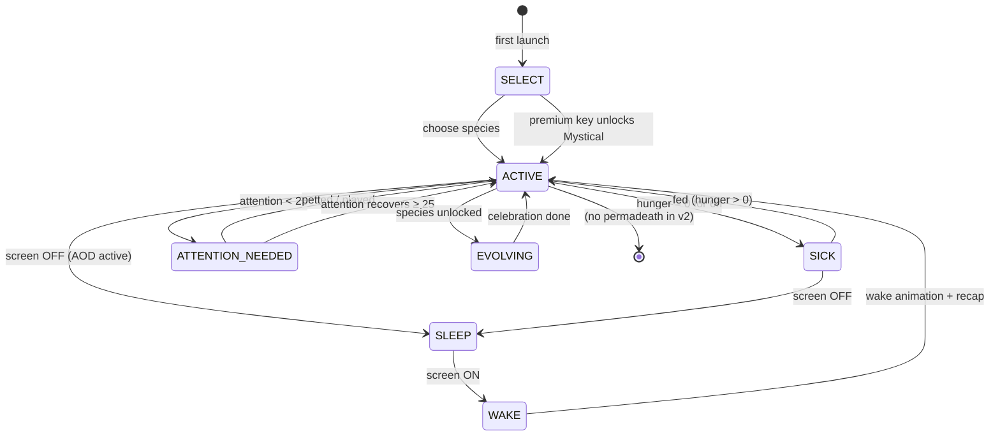
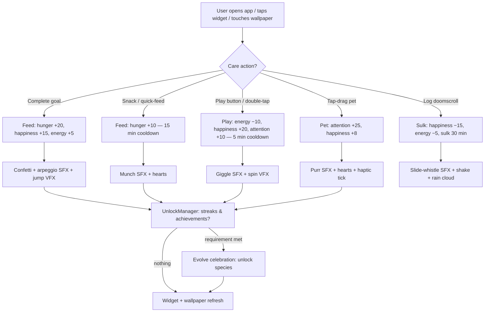
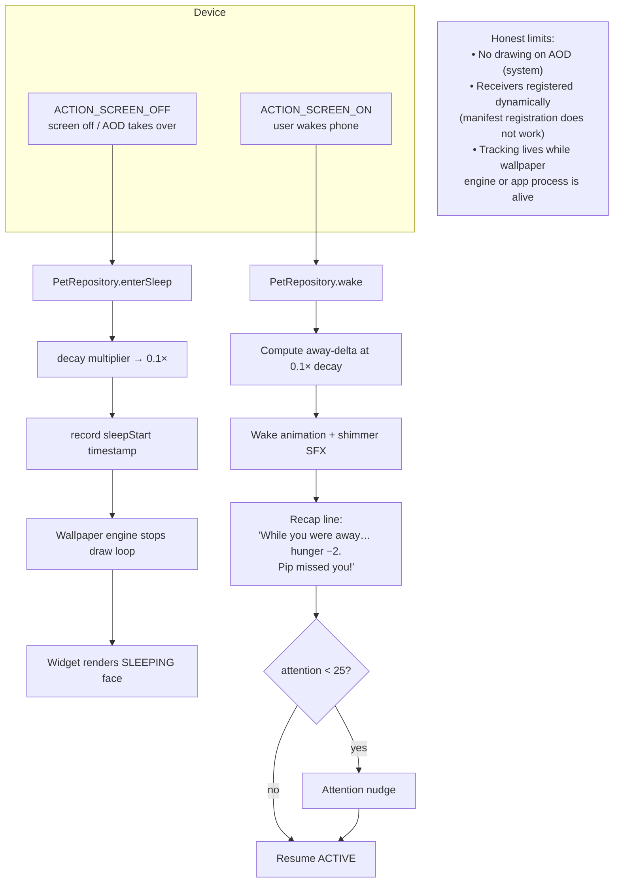
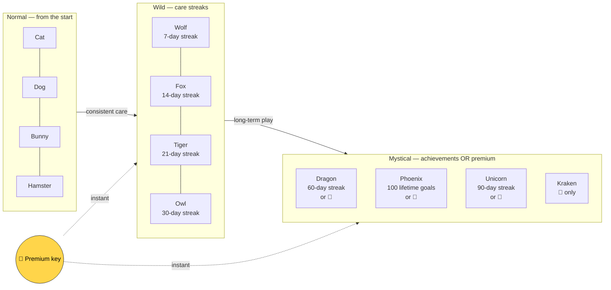
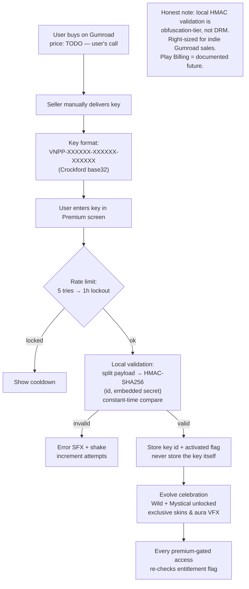
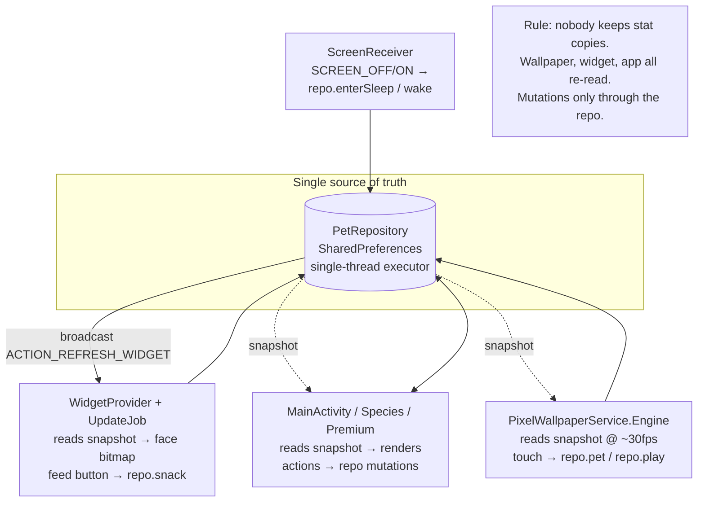

# PixelPet — Flow Charts (v2)

> GitHub renders Mermaid natively. Each diagram matches the v2 spec in
> [PLAN.md](PLAN.md). The animation bible lives in [ART.md](ART.md).

## (a) Pet lifecycle state machine

## (b) Care loop — feed / play / attention

## (c) Sleep / wake cycle (screen on/off)

## (d) Unlock progression (Normal → Wild → Mystical)

Care-day rule: **≥1 goal completed in a calendar day** extends the streak.
Streaks use wall-clock dates (a human concept); stat decay uses elapsedRealtime
(a physics concept). The split is deliberate and documented.

## (e) Premium purchase → key activation → entitlement check

## (f) Sync — wallpaper, widget, app (single source of truth)

---

*Diagrams: (a) lifecycle · (b) care loop · (c) sleep/wake · (d) unlocks ·
(e) premium · (f) sync. Spec: [PLAN.md](PLAN.md). Animation bible: [ART.md](ART.md).*
