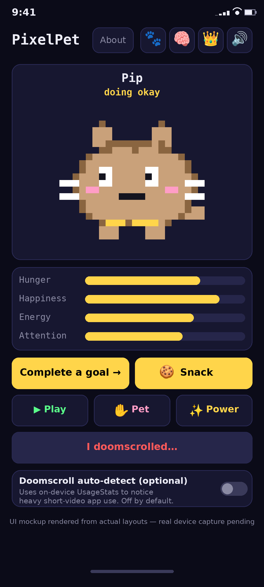

<!-- description: PixelPet — a pixel-art virtual pet that lives on your Android lock screen (live wallpaper) + home-screen widget. Raise 108 variants across Normal/Wild/Mystical; complete real-life goals to feed them, pet them for attention, and don't doomscroll. 🐾 -->

# 🐾 PixelPet


**A pixel-art virtual pet that lives on your lock screen.**
Meet **Pip** — but Pip is just the beginning. Raise **108 variants** across three
categories: **Normal** (57 — cats, dogs, bunnies, hamsters, pigs, ducks, turtles,
frogs, penguins, pandas), **Wild** (27 — wolves, foxes, tigers, owls, ox & kin,
snakes, bats), and **Mystical** (24 — dragons, phoenixes, unicorns, krakens,
axolotls, griffins). Every variant is parametric data — palette + features +
one accessory + trait bias — drawn by one renderer, not 108 hand-drawn sprites.

- 📱 **Lock-screen pet** — a live wallpaper renders Pip on your lock screen
  (Samsung: set it as the separate lock-screen wallpaper). Pip **roams** the
  wallpaper. Tap to pet, double-tap to play. *(Android removed lock-screen widgets in 5.0 — the live
  wallpaper is the real mechanism.)*
- 🚶 **Walking** — Pip roams the lock-screen wallpaper on a walk engine (idle → look → walk →
  pause), with a 2-frame walk cycle, squash-and-stretch landings, and hop turns. The in-app
  stage shows Pip standing (no roam there).
- 🧠 **Personality** — five trait axes (Playful, Bold, Greedy, Social, Neat)
  that drift with how you care for Pip, plus canned speech lines that match
  personality × mood.
- 🧠 **Native Brain** — an on-device adaptive rule system that notices patterns
  (when you usually play, your favorites) and reacts. It is **not a language
  model**: it will never chat, write, or reason. Nothing leaves your phone.
- ✨ **23 family powers** — one cute gimmick per family (Purr Heal, Fetch Gift,
  Cheek Stash, Rainbow Trail, Rebirth…) on elapsedRealtime cooldowns.
  Cosmetic-first; powers never gate progression.
- 🌙 **AOD = sleep** — third-party apps can't draw on Always-On Display, so when
  the screen goes off Pip sleeps (decay ×0.1). Wake up to a recap:
  *"While you were away…"*
- 🎯 **Feeding = real life** — complete goals (gym, study, ship a video) to feed Pip.
- ✋ **Attention meter** — pet Pip or he'll get lonely; neglect him and happiness
  drains twice as fast.
- 🌧 **Doomscroll = sulk** — manual log + optional on-device auto-detect.
- 👑 **Premium** — Wild + Mystical pets, aura skins, via
  license-key activation (Gumroad pattern). *Price: TODO — one-time, user's call.*
  Premium changes LOOK only, never powers or progression.

> ✦ VN ✦ — Made by Vivek Nair

## Screenshot



*Above: representative UI mockup (not a device capture) — the real app renders Pip
live on canvas with idle bounce, blinking, confetti, hearts, and sulk animations.
A real device capture will replace this mockup after the Phase 5 real-device
install test.*

## How it works

| Action | Effect on Pip |
|---|---|
| ✅ Complete a goal | +Hunger, +Happiness, confetti burst, happy arpeggio |
| 🍪 Snack (widget/app) | +Hunger, 15-min cooldown |
| ▶ Play (double-tap pet) | −Energy, +Happiness, +Attention, giggle |
| ✋ Pet (tap pet / touch wallpaper) | +Attention, +Happiness, purr, hearts |
| ✨ Use family power | Cosmetic effect + cooldown (e.g. Cheek Stash auto-feeds later) |
| 📱 Log doomscrolling (or auto-detect) | −Happiness, Pip sulks for 30 min |
| ⏰ Time passes | Stats decay hourly; attention drains when ignored |
| 🌙 Screen off | Pip sleeps — decay ×0.1, wake shows a recap |

**Unlocks:** Normal variants available from the start; Wild via care streaks
(7/14/21/30 days); Mystical via long-term achievements (60/90-day streaks,
100 lifetime goals) **or** 👑 Premium. The Kraken is premium-only — the white whale. 🦑

**Doomscroll auto-detect (optional, off by default):** uses Android's on-device
UsageStats API to notice heavy short-video app use (TikTok / Instagram / YouTube)
and auto-logs once per day. Nothing ever leaves your phone — it works fully offline.

**Walking / wallpaper roam:** Pip roams the lock-screen wallpaper on the walk engine,
bounded to the canvas. The in-app stage does not roam — Pip stands there. The wallpaper loop
runs at ~30fps only while visible and the screen is on, and roam pauses after
30s with no interaction. AOD still cannot be drawn on by third-party apps.

**Widget:** the home-screen widget is a snapshot bitmap — RemoteViews cannot host
a live view — that renders Pip's current walk frame plus 4 mini stat bars,
re-rendered on every stat tick and on tap. Quick-feed button included.

## Features

- 📱 **Lock-screen live wallpaper** — Pip roams on every wake; tap to pet, double-tap to play
- 🏠 **Home-screen widget** — snapshot bitmap of Pip's current walk frame + 4 mini stat bars + quick-feed button
- 🐾 **108 variants, 3 categories** — parametric pixel-art renderer, one code path
- 🚶 **Walking** — walk engine with roam states, walk cycle, squash & stretch
- 🧠 **Personality** — 5 trait axes that drift with care + speech lines
- 🧠 **Native Brain** — on-device adaptive rules; not a language model
- ✨ **23 family powers** — one per family, elapsedRealtime cooldowns
- 🔓 **Unlock progression** — care streaks and achievements (or premium shortcut)
- 👑 **Premium tier** — HMAC license-key activation, aura skins (Gold Orbit, Rainbow Trail, Ember Glow, Starlight, No Aura) — look only
- 🎯 **Goal tracker** — daily or one-shot goals with streaks; completing one feeds Pip
- ✋ **Attention loop** — petting, "needs attention" states, rate-limited nudges
- 🌙 **Sleep/wake** — screen off sleeps Pip (0.1× decay), wake shows a recap
- 🌧 **Doomscroll logging** — manual button + optional UsageStats auto-detector
- 🔊 **17 synthesized SFX** — generated in code at first launch; **zero audio files**
- ✨ **Canvas VFX** — idle bounce, blinking, confetti storms, hearts, screen shake, sleep Z's
- 📳 **Haptic patterns** — per-event effects that respect mute + system settings
- 🔇 **Mute toggle**, 📌 first-launch widget pin prompt, 📴 full offline support

## Build

Requires JDK 17. No API keys, no paid services, no accounts.

**Compatibility:** Android 8.0 (API 26) or newer — minSdk 26, zero external
dependencies, no Google Play Services, no network calls. Every Android API
call in the app is audited against API 26 (calls above 26 are
version-guarded). Real-device coverage is tracked in
[DEVICE_TEST.md](DEVICE_TEST.md) — results are pending user testing; no
device is claimed as verified until it is actually run.

```bash
./gradlew assembleDebug
# APK: app/build/outputs/apk/debug/app-debug.apk
```

CI: a GitHub Actions workflow (`.github/workflows/android.yml`) builds the
debug APK on every push and uploads it as the `pixelpet-debug-apk` artifact.
Current status (2026-10-13): CI is RED — it fails at the "Set up Android SDK"
step because `android-actions/setup-android@v3` installs the legacy `tools`
package, which Google removed from the SDK repository. Fix: change the
workflow (via the GitHub web UI — the API cannot edit workflow files) to
`android-actions/setup-android@v4`, then re-run. Until CI is green, build
locally with `./gradlew assembleDebug`.
Real-device install test: see DEVICE_TEST.md (pending).

**Sideloading on Android 13+:** after installing the APK, grant
*Settings → Apps → PixelPet → ⋮ → Allow restricted settings* if the system
prompts you — required for sideloaded apps requesting special access.

## Project structure

```
app/src/main/
├── AndroidManifest.xml
├── java/com/vn/pixelpet/
│   ├── MainActivity.kt        # pet stage, 4 stats, feed/play/pet/doomscroll
│   ├── SpeciesActivity.kt     # variant roster, lock states, evolve FX
│   ├── PremiumActivity.kt     # HMAC license-key activation + aura skins
│   ├── GoalsActivity.kt       # goal list (add / complete / delete, streaks)
│   ├── AboutActivity.kt       # how-to-play, ✦ VN ✦ signature, platform notes
│   ├── PersonalityActivity.kt # trait bars + learned-behavior lines
│   ├── Species.kt             # 12 base families: palettes, features, unlock text
│   ├── Variant.kt             # 108-variant roster (palette, features, accessory, trait bias)
│   ├── PetView.kt             # canvas pet + particle VFX engine
│   ├── PetRenderer.kt         # parametric renderer (shared: app, widget, wallpaper)
│   ├── PetState.kt / PetRepository.kt   # single source of truth
│   ├── WalkEngine.kt          # roam state machine, walk cycle, delta-time movement
│   ├── Personality.kt         # 5 trait axes, seed/nudge/decay, summary line
│   ├── SpeechBank.kt          # canned lines per personality × mood, no-repeat window
│   ├── NativeBrain.kt         # on-device adaptive rules (not a language model)
│   ├── PowerManager.kt        # 23 family powers, elapsedRealtime cooldowns
│   ├── AuraSkin.kt            # premium aura skins (look only)
│   ├── UnlockManager.kt       # streak/achievement evaluation
│   ├── PremiumManager.kt      # key validation, entitlements
│   ├── SfxEngine.kt           # 17 synthesized sounds, SoundPool
│   ├── Haptics.kt             # per-event vibration patterns
│   ├── Goal.kt                # goal model (org.json, no libraries)
│   ├── wallpaper/             # lock-screen live wallpaper (roam, tap = pet)
│   ├── widget/                # glanceable widget (walk-frame snapshot) + quick-feed
│   ├── doomscroll/            # optional UsageStats auto-detector
│   └── util/                  # boot rescheduler, screen on/off, notifications
└── res/                       # layouts, drawables, values, widget/wallpaper info
```

**Design decisions worth knowing:**

- **Zero external dependencies** — framework APIs only (no AndroidX, no libraries).
  Fewer moving parts, faster CI, nothing to break on version bumps.
- **Time model** — decay runs on `elapsedRealtime` deltas with a wall-clock fallback
  and a 48-hour cap, so reboots and clock changes can't corrupt Pip.
- **Widget face = one bitmap** — RemoteViews can't host custom views, so the provider
  renders Pip's current walk frame + bars + label into a single bitmap per update.
- **Wallpaper roam** — the same WalkEngine bounded to the wallpaper canvas; the loop
  runs only while visible and the screen is on; roam pauses after 30s idle; the pet
  bitmap is cached by render key and pet state is refreshed at most twice a second,
  so the steady draw path does no per-frame storage writes.
- **Premium = look only** — aura skins restyle glow particles; no stat, cooldown,
  or unlock effect. Key validation stays HMAC local-check (obfuscation-tier).
- **Native Brain = adaptive rules, not a language model** — it notices patterns and
  reacts; it will never chat, write, or reason.
- **Audio never blocks UI** — WAVs synthesize on a background thread; `play()` is a
  no-op until loading completes.

Full architecture, bug analysis, and honest platform notes: [PLAN.md](PLAN.md).
Flow charts (Mermaid): [FLOW.md](FLOW.md). Animation bible: [ART.md](ART.md).
V3 plan (108 variants, walking, personality, Native Brain, 23 powers): [PLAN_V3.md](PLAN_V3.md).

## Roadmap

Phase 5: full golden suite, migration test, frame-time test, real-device install
tests across the device matrix (see DEVICE_TEST.md), real screenshot capture. Beyond that: Goal XP levels · pet
evolution stages · "Pip misses you" reminders · Wear OS tile · per-app pickers
for auto-detect · cloud backup.

## License

MIT — do whatever you want with it. If Pip guilt-trips you into going to the gym,
the system works.
